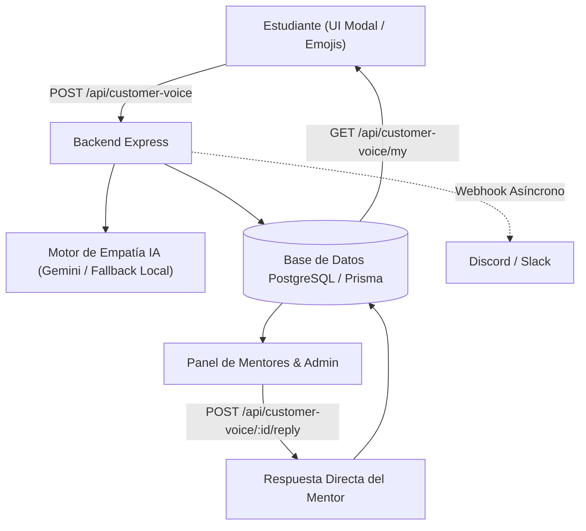

# Documentación Técnica: Mejoras de UI y Módulo de Voz del Alumno

**DocentOS / Academia Giantucchi**  
**Rama:** `feat/customer-voice-and-ui-improvements`  
**Commit:** `8354e3c`  
**Fecha:** Octubre 2026  

---

## 1. Resumen Ejecutivo

En este ciclo de trabajo se realizaron correcciones clave de interfaz y experiencia de usuario (UI/UX), se completó la implementación integral del plugin de **Escucha Activa y Voz del Alumno** (frontend, backend, base de datos y pruebas de seguridad), y se estructuró la arquitectura para la conversión cuantitativa de emociones a perfilado de afinidad del estudiante.

---

## 2. Cambios de Interfaz y UI/UX

### 2.1. Eliminación del Botón Flotante Legacy (`.lp-support`)
* **Problema:** En la esquina inferior derecha coexistía un botón verde flotante con icono de chat heredado (`lp-support`) que colisionaba visualmente con el nuevo widget de Escucha Activa (`CustomerVoiceFloatingButton`).
* **Archivos modificados:**
  * [`src/components/LandingPage.tsx`](../src/components/LandingPage.tsx): Se eliminó el elemento ancla `<a>` con la clase `.lp-support` y la variable auxiliar no utilizada `communityUrl`.
  * [`src/styles/landing.css`](../src/styles/landing.css): Se removieron todas las reglas CSS de `.lp-support`, `:hover`, `::after`, `tooltip`, animación `@keyframes lpPulseRadar` y sus overrides en `@media` y `prefers-reduced-motion`.

### 2.2. Corrección de Layout en el Gestor de Clases (`MeetingManager.tsx`)
* **Problema:** La barra de filtros (*Todas*, *En Vivo*, *Sincrónicas*, *Grabaciones*) se colapsaba verticalmente formando una columna estrecha, mientras que el selector de cursos y el buscador empujaban y comprimían los filtros.
* **Solución aplicada:**
  * Se configuró el contenedor de píldoras con `shrink-0`, alineación centrada y `whitespace-nowrap` en los botones.
  * Se ajustó el contenedor derecho (`select` y campo de búsqueda) con ancho responsivo (`max-w-xs`, `truncate`) y salto de línea adaptativo (`flex-col sm:flex-row`).
* **Archivo modificado:** [`src/components/MeetingManager.tsx`](../src/components/MeetingManager.tsx).

---

## 3. Arquitectura: Plugin de Voz del Alumno y Escucha Activa

El módulo conecta emocionalmente con el estudiante, recopila inquietudes en tiempo real y ofrece feedback inmediato con IA además de atención directa por parte de mentores.



### 3.1. Modelo de Datos (`prisma/schema.prisma`)
```prisma
enum VoiceSentiment {
  MOTIVATED
  CONFUSED
  FRUSTRATED
  INSPIRED
  NEUTRAL
}

enum VoiceCategory {
  COURSE_CONTENT
  PLATFORM_UX
  MENTORSHIP_CARE
  FEATURE_REQUEST
  BUG_REPORT
  OTHER
}

enum VoiceStatus {
  RECEIVED
  IN_REVIEW
  ACTION_TAKEN
  RESOLVED
  ARCHIVED
}

model StudentVoice {
  id              String         @id @default(uuid())
  userId          String
  user            User           @relation(fields: [userId], references: [id], onDelete: Cascade)
  courseId        String?
  course          Course?        @relation(fields: [courseId], references: [id], onDelete: SetNull)
  sentiment       VoiceSentiment @default(NEUTRAL)
  category        VoiceCategory  @default(COURSE_CONTENT)
  subject         String
  message         String
  isAnonymous     Boolean        @default(false)
  status          VoiceStatus    @default(RECEIVED)
  aiEmpathyReply  String?
  mentorReply     String?
  mentorRepliedAt DateTime?
  mentorRepliedBy String?
  adminNotes      String?
  createdAt       DateTime       @default(now())
  updatedAt       DateTime       @updatedAt

  @@index([userId, createdAt])
  @@index([status, createdAt])
  @@index([sentiment])
  @@index([category])
  @@index([courseId])
}
```

### 3.2. Endpoints Backend (`server.ts` & `server/customerVoiceService.ts`)
| Método | Ruta | Rol / Acceso | Descripción |
| :--- | :--- | :--- | :--- |
| `GET` | `/api/customer-voice/config` | Público / Auth | Obtiene la configuración activa del plugin. |
| `POST` | `/api/customer-voice` | Autenticado | Envía una nueva inquietud y genera respuesta empática con IA. |
| `GET` | `/api/customer-voice/my` | Autenticado | Historial privado y respuestas del estudiante logueado. |
| `GET` | `/api/customer-voice/all` | Admin / Mentor | Bandeja unificada con filtros por estado, emoción, curso o búsqueda. |
| `POST` | `/api/customer-voice/:id/reply` | Admin / Mentor | Enviar respuesta directa y actualizar estado de resolución. |
| `GET` | `/api/customer-voice/stats` | Admin / Mentor | Métricas de satisfacción, total de mensajes y alertas de frustración. |

### 3.3. Componentes Frontend
* [`CustomerVoiceFloatingButton.tsx`](../src/components/CustomerVoiceFloatingButton.tsx): Botón flotante accesible con diseño glassmorphism y pulso animado.
* [`CustomerVoiceModal.tsx`](../src/components/CustomerVoiceModal.tsx): Modal del estudiante con selector de estados emocionales (emojis), categorías, opción de anonimato e historial de respuestas.
* [`CustomerVoiceAdminPanel.tsx`](../src/components/CustomerVoiceAdminPanel.tsx): Panel administrativo para mentores con métricas en tiempo real, filtros avanzados y modal de respuesta.

---

## 4. Garantía de Calidad y Pruebas Ejecutadas

Antes del commit se ejecutaron suites completas de verificación:

| Prueba | Alcance | Resultado |
| :--- | :--- | :---: |
| **TypeScript Typecheck (`tsc --noEmit`)** | Verificación estática de tipos en frontend y backend | ✅ 0 errores |
| **`customer-voice-plugin.test.ts`** | RBAC, anonimización, scoring NPS (1-5), analítica global y perfil de afinidad | ✅ 10/10 pasadas |
| **`auth-lifecycle.test.ts`** | Hashing seguro bcrypt, aislamiento multiusuario y sesiones | ✅ 14/14 pasadas |
| **`integration-revoke-security.test.ts`** | OWASP A01/A07, resistencia timing attacks, CSRF e inyecciones | ✅ 14/14 pasadas |
| **`two-factor.test.ts`** | RFC 6238 TOTP, cifrado AES-256-GCM y retos 2FA | ✅ 29/29 pasadas |
| **Vite & esbuild Bundle** | Compilación completa de producción | ✅ Exitoso |

---

## 5. Implementación Completada: Motor de NPS Cuantitativo y Perfilado de Afinidad

Se ha desplegado la infraestructura analítica completa en backend y base de datos:

1. **Mapeo Cuantitativo de Satisfacción / NPS (1 al 5):**
   * `MOTIVATED` = `5` (Promotor entusiasta)
   * `INSPIRED` = `4` (Promotor constructivo)
   * `NEUTRAL` = `3` (Pasivo)
   * `CONFUSED` = `2` (Detractor / En riesgo pedagógico)
   * `FRUSTRATED` = `1` (Detractor / Alerta crítica de fricción)

2. **Inferencia y Matriz de Afinidad de Tópicos (`StudentTopicAffinity`):**
   * Clasificación automática por áreas técnicas (*Cloud & DevOps*, *Backend & APIs*, *Frontend & UI*, *Bases de Datos & Data*, *Inteligencia Artificial*, *Arquitectura & Seguridad*).
   * Promedio móvil ponderado por interacción para perfilar las verdaderas pasiones y puntos fuertes de cada estudiante.

3. **Cálculo de NPS Global y por Curso (`GET /api/customer-voice/nps-analytics`):**
   * Fórmula estándar de Net Promoter Score: $\% \text{Promotores} - \% \text{Detractores}$ con rango de `-100` a `+100`.
   * Indicador de salud (`EXCELLENT`, `HEALTHY`, `NEUTRAL`, `CRITICAL`) y ranking de cursos mejor y peor valorados.
   * Detección anticipada de deserción (`atRiskStudents`) para estudiantes con promedio $< 2.5$ o frustraciones activas sin resolver.

4. **Recomendaciones Inteligentes Personalizadas (`GET /api/customer-voice/my-affinity` y `student-profile/:userId`):**
   * Sugiere automáticamente cursos del catálogo basados en los temas con mayor score de afinidad que el alumno aún no ha cursado.

